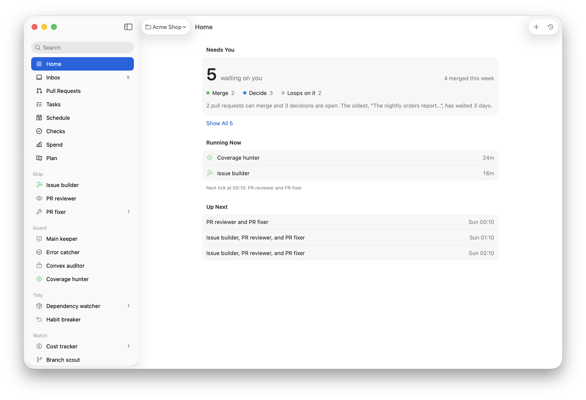

# Loops

Recurring Claude Code agents that keep a repo moving while you work on something else. Each loop does one job on a schedule: build the next ready issue into a pull request, review every new PR head, fix the review's findings and red checks on its own PRs, keep `main` green, pin merged changes with tests, flag drifting dependencies. A person still merges.

<picture>
  <source media="(prefers-color-scheme: dark)" srcset="docs/screenshot-dark.png">
  
</picture>

Loops is two Claude Code plugins and a macOS menu bar app:

- **`loops`**: the runner, its tick workflow, the review panel and eight general loops for any GitHub repo;
- **`loops-convex`**: three loops for a [Convex](https://convex.dev) backend: function review, cost, and production errors;
- **`app/`**: Loops.app, which shows what every loop is doing, what needs you, the PR pipeline, spend and schedule, and starts, pauses and edits loops.

## How it works

A background Claude Code session, the **runner**, lives in a worktree of your repo (`.claude/worktrees/loop-runner`) and runs `/loop 1h /loops:runner`. Each tick it asks `loop-runner inputs` what each loop last did, runs the `loops:tick` workflow, and the workflow dispatches the loops that are due, four at a time, each as its own agent in its own worktree. A loop that changed nothing it watches is skipped. A loop returns its state, a brief and a lesson; the runner records them and the next run reads them.

Loops run on one set of rules, [`plugins/loops/conventions.md`](plugins/loops/conventions.md): lock, window since the last run, worktree, gate before every push, one PR per loop, a brief at the end. A loop that wants independent reviewers asks for a panel ([`panel.md`](plugins/loops/panel.md)) and the runner runs it.

When the runner's account hits its usage limit, the watchdog moves it to the next account: the repo's own accounts first, then shared ones. Accounts and limits are kept once per machine in `~/.loops/`, so several repos can share accounts without stepping on each other.

## The loops

| Loop | Plugin | Default cadence | Ships |
|---|---|---|---|
| `loop-issue-queue` | loops | hourly | a PR per `ready-for-agent` issue, reviewed before it opens |
| `loop-pr-review` | loops | hourly | a verdict review on every open PR's new head |
| `loop-pr-fix` | loops | hourly | fixes for red checks and Act on items on loop PRs |
| `loop-green-main` | loops | daily, and on a red CI run | a fix PR when main goes red |
| `loop-tests` | loops | daily | tests for merged changes no test caught |
| `loop-dep-drift` | loops | weekly | advisory fixes and safe bumps, migration notes for the rest |
| `loop-correct` | loops | weekly | one repeated mistake made impossible |
| `loop-parked-branches` | loops | weekly | a drift report on `wip/*` branches |
| `loop-convex-review` | loops-convex | daily | authz and correctness fixes for changed Convex functions |
| `loop-convex-cost` | loops-convex | weekly | one read or contention fix |
| `loop-prod-errors` | loops-convex | hourly, in working hours | one fix PR per new production error |

More ready-made loops are in [`plugins/loops/gallery/`](plugins/loops/gallery/), and a repo can add its own (`loop-admin`, or the app).

## Set up a repo

1. Add the marketplace and install the plugins for the repo, from the repo:

   ```bash
   claude plugin marketplace add korabh/loops
   claude plugin install loops@loops --scope project
   claude plugin install loops-convex@loops --scope project   # with a Convex backend
   ```

   Each Claude config folder needs the install once; accounts the runner adds with `loop-runner account add` share it.

2. In the repo, run `/loops:setup`. It reads the repo and writes `.claude/loops.json` (install, gate, CI, schedule) and `.claude/loops/project.md` (what every loop should know), enables the plugins in `.claude/settings.json` for everyone who opens the repo, and opens a PR.

3. Once that merges, start the runner from the repo: `loop-runner start` (it is on the PATH of every Claude Code session with the plugin), or add the repo in Loops.app.

Requirements: Claude Code with Workflows, `git`, `gh` signed in to GitHub, `jq`, and `bash`. The runner's notifications and the app are macOS.

### Skills the loops lean on

The loops load these skills when the repo or your user folder has them, and read their files for review panels. Without them a loop still runs, with a thinner review.

- `tdd`, `pr`, `implement-spec`, `to-spec`, `writing-for-agents`: [mattpocock/skills](https://github.com/mattpocock/skills)
- `review-spec`: adapted from Matt Pocock's code review
- `interrogate`, `blast-radius`, `correct`, `principle-explain-the-number`: pstack, by Lauren Tan (MIT)
- `code-review`: bundled with Claude Code
- `convex-authz`, `convex-reviewer`, `convex-advisor`, `convex-cost`, `convex-self-heal`: `npx convex ai-files install`

## The app

```bash
cd app && ./build.sh            # builds Loops.app into ~/Applications
LOOPS_REPO=~/code/shop ./build.sh   # pins the repo it shows
```

It needs Xcode 26 and `xcodegen`. Without `LOOPS_REPO` it shows the first repo registered in `~/.loops/config.json`. The app carries its own copy of the runner scripts.

## Develop

```bash
./test.sh           # every plugin's shell tests
./test.sh --app     # and the app's Swift tests
```

To try the plugins from a checkout: `claude --plugin-dir plugins/loops --plugin-dir plugins/loops-convex`.

## License

MIT, see [LICENSE](LICENSE). Third-party notices are in [THIRD_PARTY.md](THIRD_PARTY.md).
